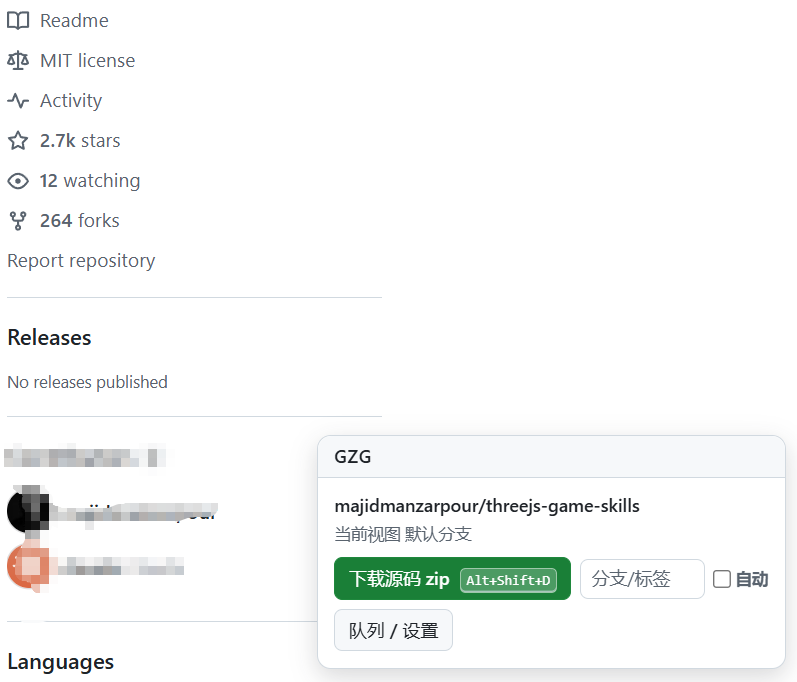
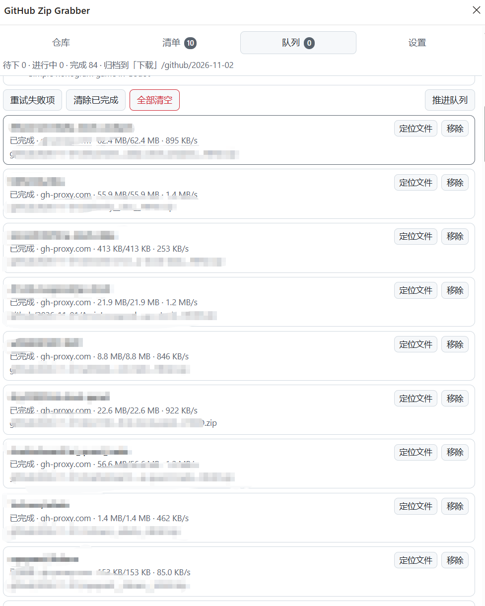

# GitHub Zip XGrabber

[简体中文](README.md) ｜ [English](README.en.md) ｜ [帮助手册 / Help](docs/help.zh-CN.md) ｜ [赞助 / Sponsor](docs/SPONSOR.md)

A browser extension (MV3) for Microsoft Edge / Google Chrome: one-click source-zip downloads on any GitHub repo page, multi-select batch downloads from search results, automatic mirror failover when direct access fails, a background serial download queue, and automatic date-based archiving.

> 浏览器扩展（Edge / Chrome，MV3）：GitHub 仓库页一键下载源码 zip，搜索结果多选批量入队，直连失败自动切镜像，后台串行队列，按日期自动归档。

---

## ✨ Features

- **One-click download on repo pages** — a floating pill at the bottom-right of every GitHub repo page; accepts any branch / tag / commit; the button shows its live keyboard shortcut (`Alt+Shift+D` by default, user-rebindable), and pressing it reports back with exactly the same message as clicking (queued / `跳过：已下载过` / failure reason) plus a halo pulse on the button it maps to
- **Default branch resolved automatically** — uses `archive/HEAD.zip`, so `master`, `main` or anything else works; consumes **zero** GitHub API quota
- **Batch download from search results** — detects every repo on a search page (`type=repositories`), collects results across pages with de-duplication, sortable by stars / last update, multi-select and enqueue
- **Automatic mirror failover** — ships with direct connection + 3 public mirrors; failed downloads retry on the next source; sources are ranked by measured throughput; failing sources cool down for 5 minutes; custom mirror templates supported
- **Background serial queue** — queue state is persisted, so tasks survive service-worker idle shutdown; stalled downloads are detected and retried on another source; desktop notification when the queue drains
- **Date-based archiving** — files land in `Downloads/github/2026-10-10/xxx.zip`; duplicates get a `(1)` suffix instead of being overwritten
- **Download verification** — rejects fake zips (error pages disguised as `.zip` by mirrors) via Content-Type + size checks; bad files are cleaned up and retried elsewhere

## 📦 Install

1. Clone or download this repository
2. Open `edge://extensions/` (or `chrome://extensions/` in Chrome) and enable **Developer mode**
3. Click **Load unpacked** and select this folder (the one containing `manifest.json`)
4. Optionally pin the icon; shortcuts can be changed at `edge://extensions/shortcuts`

Step-by-step with screenshots: [Help manual (English)](docs/help.en.md#2-installation--uninstall).

## 🚀 Quick Start

1. Open any GitHub repo, e.g. `https://github.com/alchaincyf/huashu-design`
2. Click **下载源码 zip** (Download source zip) on the floating pill at the bottom-right
3. Find the file in `Downloads/github/2026-10-10/alchaincyf__huashu-design__HEAD.zip`

Batch mode: open a GitHub repository search page, click **收集本页 N 个** (collect this page) or **本页全部入队** (enqueue whole page) on the pill; or tick repos in the side panel's **清单** (List) tab and hit **下载选中** (Download selected).

## 📖 Documentation

| Document | Contents |
|---|---|
| [Help manual (English)](docs/help.en.md) ｜ [帮助手册（中文）](docs/help.zh-CN.md) | Installation, UI walkthrough, every setting explained, error-code table, FAQ, known limitations |
| [Design notes (Chinese)](docs/DESIGN.zh-CN.md) | Key technical decisions backed by measurements (HEAD.zip, no-resume, MIME verification, the MV3 deadlock fix) and test results |
| [Sponsor](docs/SPONSOR.md) ｜ [赞助](docs/SPONSOR.md) | If this tool saved you time |

## 🖼 Screenshots

> Screenshots live in `docs/images/`; see the shot list appendix in the help manual.

| Repo pill | Search list | Queue |
|:---:|:---:|:---:|
|  |  |  |

## ⚙️ Defaults

| Setting | Default | Notes |
|---|---|---|
| Shortcuts | `Alt+Shift+G` panel / `Alt+Shift+D` download current repo | Rebindable at `edge://extensions/shortcuts`; the UI shows the **currently active** binding |
| Root folder | `github` | First-level folder inside Downloads; nesting like `code/github` is allowed |
| Date style | `YYYY-MM-DD` | Alternatives: `YYYYMMDD` / `YYYY-MM` / none |
| Concurrency | `1` (strictly serial) | 1–4 |
| Max attempts per item | `8` | Counted across all sources |
| Stall detection | `90` s without progress | Cancel and switch source |
| Minimum valid size | `64` bytes | Together with the Content-Type check |
| Name conflicts | append `(1)` | Can be switched to overwrite |

## 🧪 Testing

```bash
bash tests/run.sh              # pure-function regression (78 assertions)
python tests/e2e_browser.py    # real-browser end-to-end (needs local playwright + chromium)
python tests/make_fixtures.py  # regenerate the search-page structure-drift fixtures
```

Current status: 78/78 unit assertions pass; **49/49 end-to-end checks pass**, 1 skipped due to a harness limitation (see [design notes](docs/DESIGN.zh-CN.md)). The scraper additionally runs against three drift fixtures (real snapshot / every class renamed / even the `results-list` testid removed) — all must yield 10 repos with stars, language, updated date and description.

## ⚠️ Known Limitations

- Files can only be written **inside the browser's default Downloads folder** — arbitrary drive paths are impossible from an extension (hard API boundary)
- The zip is GitHub's server-side source snapshot: **no** `.git` history, submodules, or Git LFS objects
- Public mirrors come and go; prune dead ones in Settings
- GitHub rate-limits anonymous requests; for very large batches (hundreds of repos) work in chunks
- Only `type=repositories` search pages are handled

## 🔒 Privacy

The extension **collects and uploads nothing**. Settings, queue and logs live only in local `chrome.storage`; network access happens solely to `github.com`, `codeload.github.com`, `api.github.com` and the mirrors you configure.

## 💬 Feedback

Please open an [Issue](../../issues). Running the test suite first makes bug reports much more actionable.

## ❤️ Sponsor

If this tool saved you time, [buy me a coffee](docs/SPONSOR.md).
