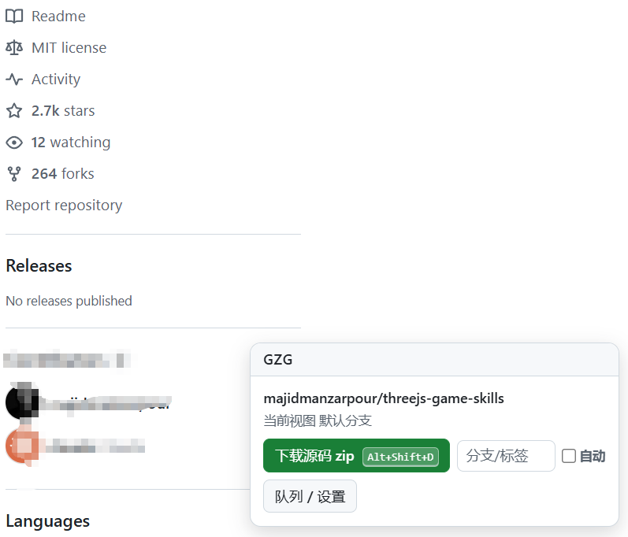
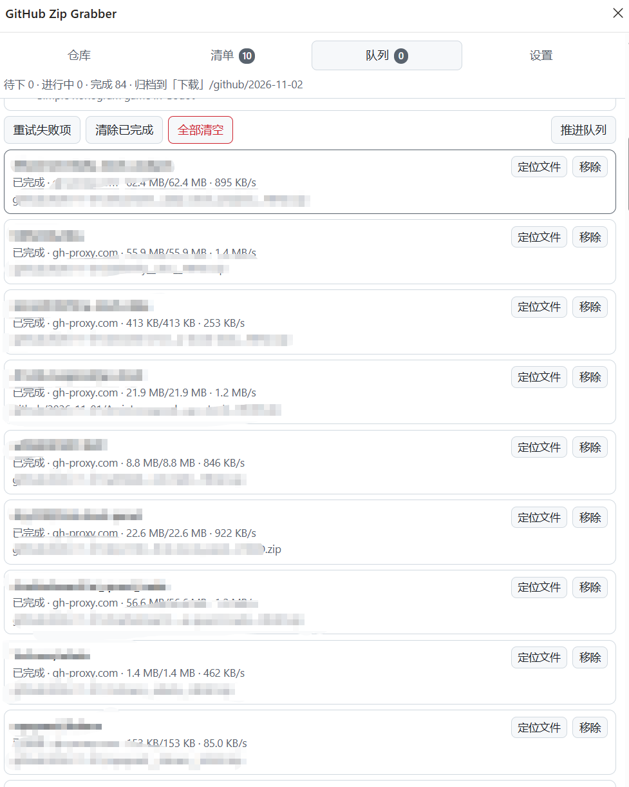

# GitHub Zip Grabber

[简体中文](README.md) ｜ [English](README.en.md) ｜ [帮助手册 / Help](docs/help.zh-CN.md) ｜ [赞助 / Sponsor](docs/SPONSOR.md)

一个 Edge / Chrome 浏览器扩展（MV3）：在 GitHub 仓库页一键下载源码 zip，在搜索结果页多选批量入队；直连失败自动切换镜像；后台串行队列；全部按「下载目录 / 项目目录 / 日期」自动归档。

> A browser extension (MV3) for Edge / Chrome: one-click source-zip downloads on any GitHub repo page, multi-select batch downloads from search results, automatic mirror failover, a background serial queue, and date-based archiving.

---

## ✨ 功能特性 / Features

- **仓库页一键下载**：页面右下角常驻控制条，点一下即入队；可填任意分支 / 标签 / commit；按钮上直接显示快捷键（`Alt+Shift+D`，可自定义），按快捷键会给出与点按钮完全相同的提示（新入队 / `跳过：已下载过` / 失败原因），并闪一下按钮光环标出它对应哪个按钮
- **默认分支自动解析**：使用 `archive/HEAD.zip`，`master` / `main` 或任何默认分支名都正确，不消耗 GitHub API 配额
- **搜索结果批量下载**：搜索页（type=repositories）自动识别本页全部仓库，收集清单支持跨页累加去重、按 star / 更新时间排序、多选批量入队
- **自动镜像降级**：内置 直连 + 3 个公共镜像，失败自动换源重试；按历史实测速度排序，失败源冷却 5 分钟；支持自定义镜像模板
- **后台串行队列**：状态持久化，浏览器/service worker 休眠不丢任务；卡死自动检测换源；完成后系统通知
- **按日期归档**：自动创建 `下载/github/2026-10-10/xxx.zip` 式目录，重名自动加 `(1)` 不覆盖
- **结果校验**：拒绝镜像用错误页冒充的假 zip（Content-Type + 体积双重校验），坏文件自动清理并换源重下

## 📦 安装 / Install

1. 下载或克隆本仓库到本地
2. Edge 打开 `edge://extensions/`（Chrome 为 `chrome://extensions/`），开启右上角/左下角【开发者模式】
3. 点击【加载解压缩的扩展】，选择本目录（含 `manifest.json` 的那一层）
4. （可选）把图标固定到工具栏，快捷键可在 `edge://extensions/shortcuts` 修改

详细图文步骤见 [帮助手册](docs/help.zh-CN.md#2-安装与卸载)。

## 🚀 快速上手 / Quick Start

1. 打开任意 GitHub 仓库，例如 `https://github.com/alchaincyf/huashu-design`
2. 点右下角控制条的 **【下载源码 zip】**
3. 完成后到 `下载/github/2026-10-10/` 找 `alchaincyf__huashu-design__HEAD.zip`

批量：打开 GitHub 搜索结果页（如 `animation skill` 仓库搜索），控制条点【收集本页 N 个】或【本页全部入队】；或在侧边栏【清单】里勾选后【下载选中】。

## 📖 文档 / Documentation

| 文档 | 内容 |
|---|---|
| [帮助手册（中文）](docs/help.zh-CN.md) ｜ [Help (English)](docs/help.en.md) | 安装、界面详解、设置项逐条说明、错误对照表、FAQ、已知限制 |
| [设计文档（中文）](docs/DESIGN.zh-CN.md) | 关键技术决策与实测依据（HEAD.zip、Range 不可续传、MIME 校验、MV3 死锁修复）、测试结论 |
| [赞助 / Sponsor](docs/SPONSOR.md) | 如果这个工具帮到了你 |

## 🖼 截图 / Screenshots

> 截图文件统一放在 `docs/images/`，文件名约定见 [帮助手册附录：截图清单](docs/help.zh-CN.md#附录截图清单)。
> Screenshots live in `docs/images/`; see the shot list in the help manual.

| 仓库页控制条 Repo pill |  下载队列 Queue |
|:---:|:---:|:---:|
|  |   |

## ⚙️ 默认参数 / Defaults

| 参数 | 默认值 | 说明 |
|---|---|---|
| 快捷键 | `Alt+Shift+G` 开面板 / `Alt+Shift+D` 下载当前仓库 | 在 `edge://extensions/shortcuts` 自定义；界面上显示的是**当前实际生效**的绑定 |
| 总子目录 | `github` | 下载目录下的一级目录，可嵌套如 `code/github` |
| 日期格式 | `YYYY-MM-DD` | 另有 `YYYYMMDD` / `YYYY-MM` / 不分日期 |
| 并发数 | `1`（严格串行） | 可调 1–4 |
| 单条最大尝试次数 | `8` | 跨所有源累计 |
| 卡死判定 | `90` 秒无进度 | 换源重试 |
| 有效文件下限 | `64` 字节 | 配合 Content-Type 校验 |
| 重名策略 | 自动加 `(1)` | 可改为覆盖 |

## 🧪 测试 / Testing

```bash
bash tests/run.sh              # 纯函数回归（78 断言，含搜索时间归一化）
python tests/e2e_browser.py    # 真实浏览器端到端（需要本机 playwright + chromium）
python tests/make_fixtures.py  # 重新生成搜索页结构漂移夹具
```

当前状态：单元 78/78 通过；端到端 **49 项全部通过**、1 项因测试工具限制跳过（说明见 [设计文档](docs/DESIGN.zh-CN.md#已验证--未验证)）。抓取器另有三层结构漂移夹具（真实快照 / 类名全改名 / 连 testid 都抹掉），全部要求抓到 10 个仓库及 star、语言、更新时间、描述。

## ⚠️ 已知限制 / Limitations

- 只能把文件写到浏览器**默认下载目录之下**，无法指定任意盘符路径（浏览器扩展 API 的硬边界）
- zip 是 GitHub 服务端打包的源码快照：**不含** `.git` 历史、子模块、Git LFS 大文件
- 公共镜像站寿命不可控，失效时请在设置里增删
- GitHub 对匿名请求有限流，超大批量（数百仓库）建议分批
- 仅处理 `type=repositories` 的搜索页

## 🔒 隐私 / Privacy

扩展**不收集、不上传任何数据**。所有设置、队列、日志只存在浏览器本地 `chrome.storage`；网络访问仅发生在 `github.com`、`codeload.github.com`、`api.github.com` 与你自己配置的镜像站。

## 💬 反馈

问题与建议请提 [Issues](../../issues)。修 bug 前建议先跑一遍上面的测试。

## ❤️ 赞助 / Sponsor

如果这个工具帮你省了时间，[请我喝杯咖啡](docs/SPONSOR.md)。

If this tool saved you time, [buy me a coffee](docs/SPONSOR.md).
