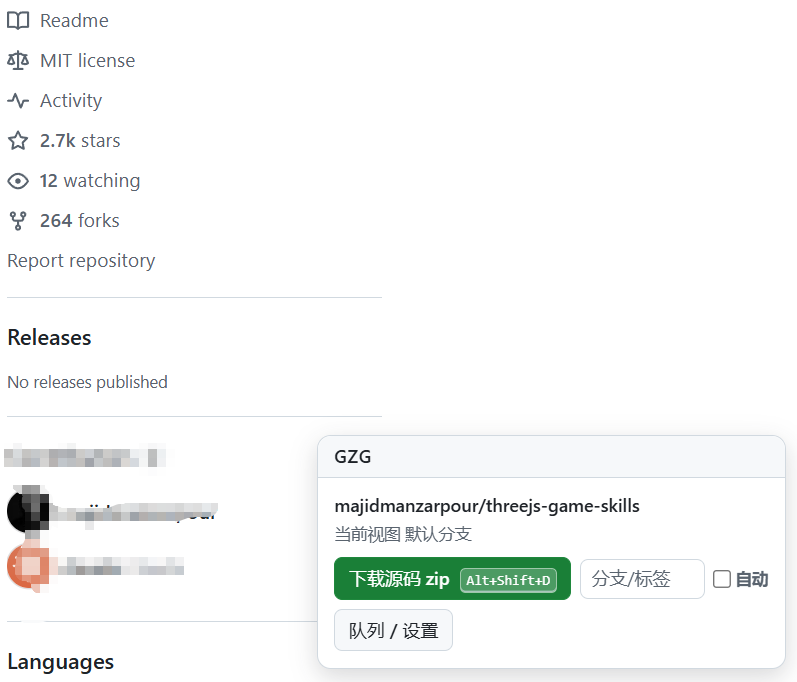
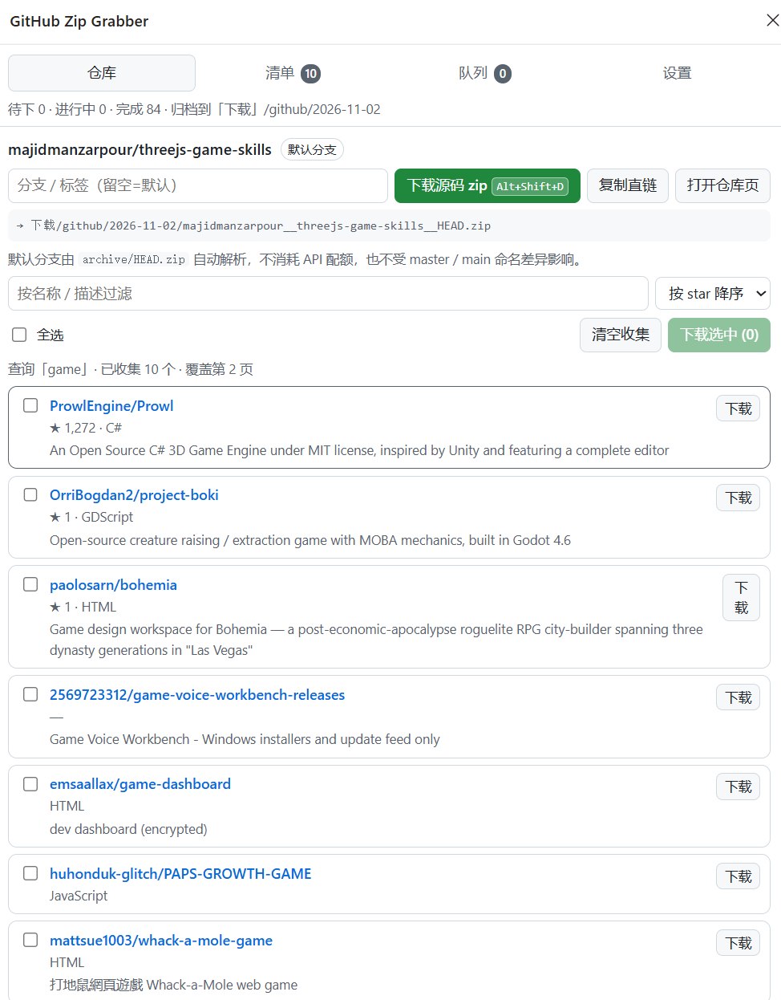
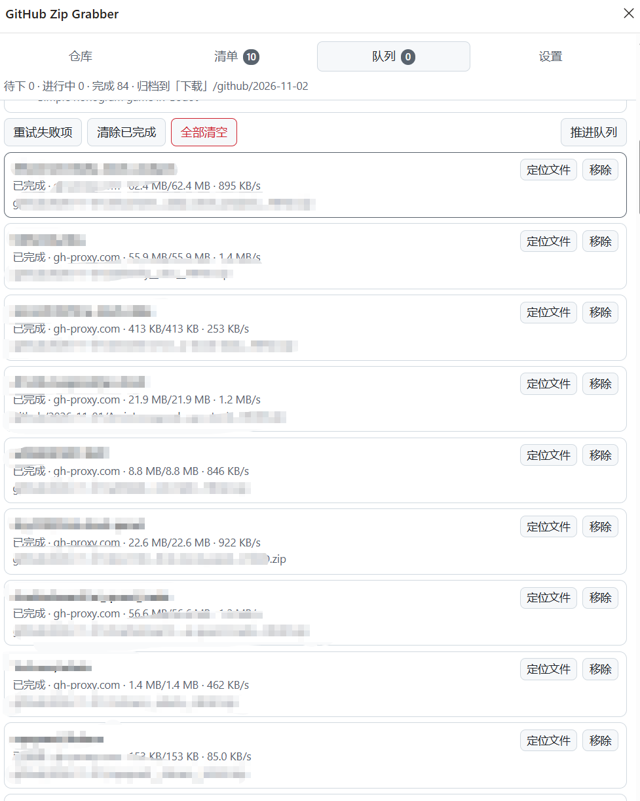
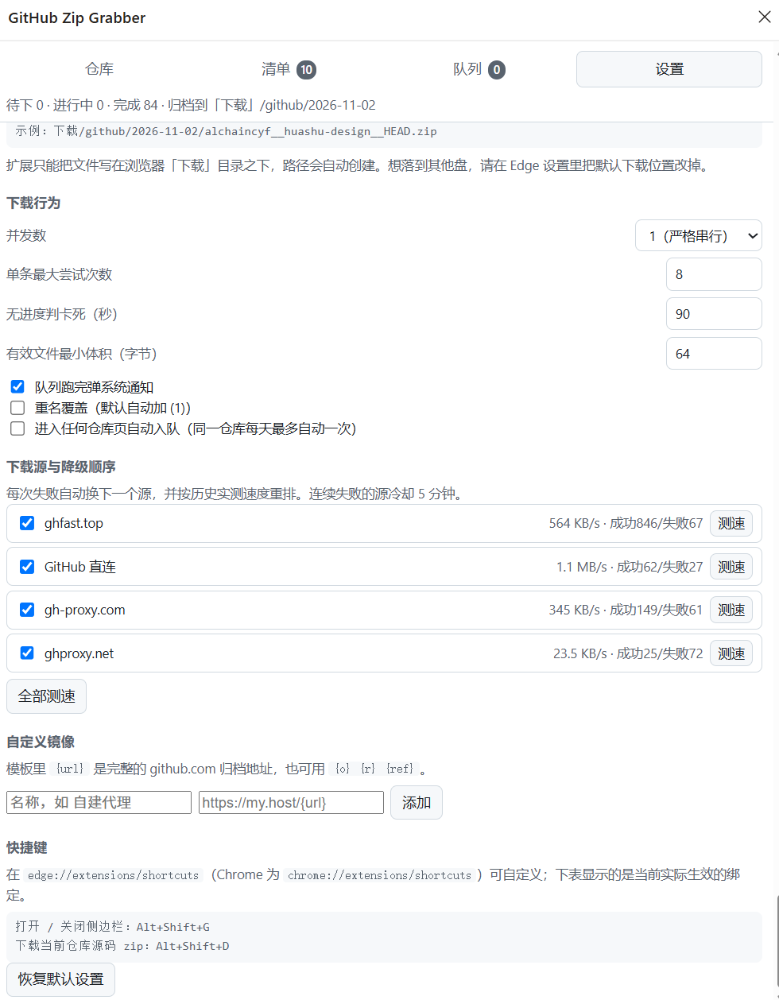

# GitHub Zip Grabber — Help Manual

[← Back to README](../README.en.md) ｜ [中文手册](help.zh-CN.md) ｜ [Sponsor](SPONSOR.md)

Applies to: v0.1.2 (Edge / Chrome, MV3)

---

## Contents

1. [What is this](#1-what-is-this)
2. [Installation & uninstall](#2-installation--uninstall)
3. [60-second quick start](#3-60-second-quick-start)
4. [The on-page pill](#4-the-on-page-pill)
5. [Side panel: Repo](#5-side-panel-repo)
6. [Side panel: List (batch download)](#6-side-panel-list-batch-download)
7. [Side panel: Queue](#7-side-panel-queue)
8. [Side panel: Settings](#8-side-panel-settings)
9. [Sources & mirrors](#9-sources--mirrors)
10. [Archiving rules](#10-archiving-rules)
11. [Auto download](#11-auto-download)
12. [Keyboard shortcuts](#12-keyboard-shortcuts)
13. [Error reference](#13-error-reference)
14. [FAQ](#14-faq)
15. [Known limitations](#15-known-limitations)
16. [Privacy & security](#16-privacy--security)
17. [Appendix: screenshot checklist](#appendix-screenshot-checklist)
18. [Sponsor](#18-sponsor)

---

## 1. What is this

Grab source-code zips while you browse GitHub:

- Repo page → one-click zip of the default branch (or any branch / tag / commit)
- Search results → collect every repo on the page (accumulates across pages), tick a few, queue them up
- Downloads run serially in the background, fail over to mirrors automatically, and are archived by date

**Not for**: full git history, submodules or LFS files (use `git clone`); writing to arbitrary drive paths (change the browser's default download location instead — see [Known limitations](#15-known-limitations)).


<!-- Shot: any repo page with the pill expanded at the bottom right -->

## 2. Installation & uninstall

### Install

1. Put this repository somewhere **stable** on disk (the extension is loaded by reference; moving the folder breaks it)
2. Open `edge://extensions/` (or `chrome://extensions/`)
3. Turn on **Developer mode** (bottom of the left rail in Edge, top-right in Chrome)


4. Click **Load unpacked**
5. Select this folder (the one containing `manifest.json`)
6. Pin the extension via the puzzle-piece menu


### Verify

- The toolbar icon appears; its badge shows the number of queued tasks
- Any GitHub repo page shows the **GZG** pill at the bottom-right

### After updating the code

Hit the **Reload** (↻) button on the extension card — no need to re-select the folder.

### Uninstall

`edge://extensions/` → **Remove** on the card. Extension data (settings, queue, logs) is deleted; **downloaded zip files are untouched**.

## 3. 60-second quick start

1. Open any GitHub repo, e.g. `https://github.com/alchaincyf/huashu-design`
2. Click **下载源码 zip** (Download source zip) on the pill
3. A green hint appears: queued → watch the side panel
4. When done, look inside your browser's **Downloads** folder:

```
Downloads/github/2026-10-10/alchaincyf__huashu-design__HEAD.zip
```

That's it. The default branch is resolved for you via GitHub's `archive/HEAD.zip` endpoint — `master` or `main`, it just works.


## 4. The on-page pill

The pill floats at the bottom-right; click the **GZG** header to collapse/expand it. GitHub navigates without full page reloads (turbo), and the pill follows along automatically.

### Repo pages (`github.com/owner/repo`)

| Element | What it does |
|---|---|
| Header | The detected `owner/repo` and the branch you are viewing |
| 下载源码 zip `Alt+Shift+D` | Enqueue this repo (default branch). The key badge on the button reflects your **currently active** binding — rebind it and the label follows |
| Branch/tag input | Empty = default branch; accepts `main`, `v1.2.3`, a commit SHA, `feature/x`. A bad ref fails loudly — it never silently downloads something else |
| **自动** checkbox | Enable auto-download for this one repo (see [Auto download](#11-auto-download)) |
| 队列 / 设置 | Open the side panel |

The pill also works on repo sub-pages (issues, releases, sub-folders) and still targets the same repo.

### Search pages (`github.com/search?...type=repositories`)

| Element | What it does |
|---|---|
| Header | `repositories · N on this page · ~M total · page X` |
| 收集本页 N 个 | Merge this page's repos into the side-panel list (accumulates across pages, de-duplicated) |
| 本页全部入队 | Enqueue every repo on this page |
| 清单 / 多选 | Open the List view in the side panel |


> Only repository search is supported for batch download; code / issues / users search pages say so explicitly.

### Other GitHub pages

The pill keeps only an open-queue button.

## 5. Side panel: Repo

Click the toolbar icon (or `Alt+Shift+G`). The first tab mirrors the **current tab's** repo:

- Repo name and a current-branch badge
- Branch/tag input (empty = default)
- 下载源码 zip — enqueue
- 复制直链 — copy the full `archive/HEAD.zip` URL
- 打开仓库页 — jump to the repo
- A live preview of the target path, e.g. `→ 下载/github/2026-10-10/alchaincyf__huashu-design__HEAD.zip`



## 6. Side panel: List (batch download)

This is where everything you collected with 收集本页 lands — **accumulated across pages, de-duplicated by `owner/repo`**.

| Control | Behavior |
|---|---|
| Filter box | Live filter on name / description / language |
| Sort | Stars desc / last update / name / collection order |
| Select all | Ticks the current (filtered) list; click again to clear |
| 清空收集 | **Clears the list you are currently looking at** (which may have been collected on another tab — the panel falls back to the most recent non-empty bucket; hover the button for a hint) |
| 下载选中 (N) | Enqueue everything ticked; already-queued/completed repos are skipped automatically |

Each row shows `owner/repo`, ★ stars, forks, language, last-update date, a two-line description, and a per-row download button.

> Last-update values are normalized to `YYYY-MM-DD` before sorting. GitHub writes them three ways (`Oct 19, 2026, 3:10 PM UTC`, `on Aug 5`, `3 days ago`); all three parse. Anything unrecognized is left blank rather than guessed into a wrong date.

The list header shows provenance: `query "…" · 10 collected · covers page 2`.


> After clearing, the list stays empty until you collect again. To switch topics: clear → new search → collect.

## 7. Side panel: Queue

One global queue; tasks from every entry point (pill, shortcut, side panel) line up here.

Header buttons:

| Button | Behavior |
|---|---|
| 重试失败项 | Reset and re-queue every failed/canceled item (attempt counters zeroed) |
| 清除已完成 | Drop done/failed/canceled rows from the list (downloaded files are untouched) |
| 全部清空 | Clear the queue and cancel in-flight downloads |
| 推进队列 | Manually poke the scheduler (normally unnecessary) |

Each row shows:

- **Status badge**: queued / downloading / done (green) / failed (red) / canceled
- Progress: bytes, live speed, attempt number, source in use
- **Target file name** (including the date folder) and the failure reason when applicable (see [Error reference](#13-error-reference))
- Row buttons: 重试 (failed) / 取消 (active) / 定位文件 (done — opens Explorer at the file) / 移除 (always)

The **run log** at the bottom records every source switch, verification failure and retry — paste it wholesale when reporting a bug.



## 8. Side panel: Settings

### Archiving

| Setting | Default | Notes |
|---|---|---|
| Root folder | `github` | First-level folder inside Downloads; empty = date folder directly; nesting like `code/github` is allowed (illegal characters sanitized) |
| Date style | `YYYY-MM-DD` | `YYYYMMDD` / `YYYY-MM` / none; **local-timezone dates**, so no off-by-one at midnight |
| Path preview | — | Live sample of the target path |

> The extension can only write **inside the browser's default Downloads folder**. To land on `Downloads/github/...`, change Edge's default download location (Settings → Downloads → Location).

### Download behavior

| Setting | Default | Notes |
|---|---|---|
| Concurrency | `1` | 1 = strictly serial (one at a time); up to 4. Serial is kindest to mirrors |
| Max attempts per item | `8` | Counted across all sources and ref spellings |
| Stall detection (seconds) | `90` | Minimum 20; zero byte-growth for that long → cancel and switch source |
| Minimum valid size (bytes) | `64` | Below this the payload is an error page (the tiniest real repo zip is ~150 B) |
| Notify when queue drains | on | "N succeeded, M failed" desktop notification |
| Overwrite duplicates | off | Off = append `(1)`; on = overwrite (careful) |
| Auto-enqueue on any repo page | off | Global auto-download switch, see [Auto download](#11-auto-download) |

### Sources & failover order

- Every source listed; ticked = enabled; rows marked `[disabled]` are skipped but can be re-enabled anytime
- Each row shows measured throughput, success/failure counters, cooldown state
- 测速 runs a real download of a tiny repo through that source; 全部测速 does all enabled ones
- Ranking: **measured speed first**; never-tested sources rank below measured ones but are guaranteed a chance; sources that failed within 5 minutes cool down at the bottom
- 删除 applies to custom mirrors only

### Custom mirrors

One template line plugs in any GitHub accelerator:

- `{url}` = the full archive URL (recommended), e.g. `https://my.host/{url}`
- Or decomposed: `https://my.host/{o}/{r}/archive/{ref}.zip`
- Label optional (defaults to the template's host)




### Restore defaults

Resets everything in the tables above (custom mirrors are wiped too — careful).

## 9. Sources & mirrors

How it works:

1. The scheduler picks the top-ranked source for each task
2. On failure (unreachable / 404 / stalled / failed verification) the source records a failure, cools down 5 minutes, and the next source takes over
3. If every source is exhausted the item is marked failed; the rest of the queue continues

Built-in sources:

| Source | Notes |
|---|---|
| GitHub direct | The raw `github.com` URL — fastest when the network allows |
| gh-proxy.com | Public mirror |
| ghfast.top | Public mirror |
| ghproxy.net | Public mirror |

> Public mirrors are short-lived by nature; one has already gone fully offline in testing. Disable or delete dead ones in Settings, or plug in your own proxy.

**Why no resume**: GitHub and the mirrors ignore HTTP `Range` requests (asking for a byte range returns the whole file), so partial files can't be resumed — failures re-download from scratch on the next source.

## 10. Archiving rules

Path formula:

```
{browser downloads folder}/{root folder}/{date}/{owner}__{repo}__{ref}.zip
```

Examples with defaults:

```
Downloads/github/2026-10-10/alchaincyf__huashu-design__HEAD.zip
Downloads/github/2026-10-10/octocat__Spoon-Knife__HEAD.zip
Downloads/github/2026-10-10/foo__bar__refs_heads_dev.zip      ← `/` in refs becomes `_`
```

- Re-downloading the same repo on the same day appends `(1)`, `(2)` … unless overwriting is enabled
- Dates use the **local timezone**
- The queue de-duplicates on `owner/repo@ref`: already-queued or already-downloaded items are skipped with a hint; to force a re-download use 重试 in the Queue tab
- Want an extra level? Set the root folder to `code/github`

## 11. Auto download

Two levels, neither noisy:

| Level | Where | Scope |
|---|---|---|
| Global | Settings → auto-enqueue on any repo page | Every repo page |
| Per repo | The **自动** checkbox on the pill | That repo only |

Guardrail: **each repo is auto-enqueued at most once per day** (refreshing the page won't flood your Downloads). Auto-download always targets the default branch.

> Both default to off — think about disk space before enabling.

## 12. Keyboard shortcuts

| Command | Default | Where it applies |
|---|---|---|
| Toggle the side panel | `Alt+Shift+G` | Global |
| Download the current repo's zip | `Alt+Shift+D` | Repo pages; same as clicking 下载源码 zip on the pill |

The active binding is shown in two places, and both follow your customization:

- the key badge on the pill's download button
- Side panel → Settings → Keyboard shortcuts (lists the real binding of both commands, or "未绑定" if unset)

Rebind at `edge://extensions/shortcuts` (or `chrome://extensions/shortcuts`). **Extensions cannot change their own shortcuts** — a browser security rule — which is why the UI reads and displays the live value instead of hard-coding it.

### What the shortcut reports back

The hotkey runs the exact same code path as the button, so the wording is identical (not a second copy):

| Situation | Message | Colour |
|---|---|---|
| Newly queued | `已入队 owner/repo（HEAD）→ 侧边栏看进度` | green |
| Already in queue | `跳过：已在队列中` | amber |
| Already downloaded | `跳过：已下载过` | amber |
| Not a repo page | `当前页面不是仓库页，快捷键未触发下载` | amber |
| Enqueue failed | `失败：<reason>` | red |

The 下载源码 zip button also pulses a green halo so it is obvious which button the key maps to. If the pill is collapsed, the message auto-expands it and fades after 6 s. A branch typed into the input is honoured by the hotkey path too.

On non-GitHub pages (no pill), the same text is delivered as a desktop notification instead.

## 13. Error reference

Failure reasons shown on queue rows:

| Message | Meaning | What to do |
|---|---|---|
| `SERVER_BAD_CONTENT` | Repo / branch / tag doesn't exist (404) | Check spelling; log into GitHub in the browser for private repos; a mistyped ref also yields this |
| `NETWORK_FAILED` / `ERR_CONNECTION_RESET/TIMED_OUT` | Network reset or timeout | Normal — the queue failovers automatically; if everything fails, check the network or swap mirrors |
| `USER_CANCELED` | Download canceled | Manually, or blocked by browser policy |
| `FILE_FAILED` | Disk write failure | Check disk space / antivirus; move the browser's download location somewhere writable |
| `发起超时（25s 内没有拿到下载句柄）` | Source accepted the connection but sent nothing | The queue already switched sources; disable chronic offenders in Settings |
| `源无响应超过 Ns` | Same, detected after recovering the handle | Same |
| `无进度超过 Ns` | Download stalled mid-flight | Auto-switched |
| `响应 Content-Type=xxx，不是 zip（疑似镜像错误页）` | Mirror served an error page disguised as a zip | Auto-switched; the source cools down |
| `文件过小（N B < 64 B…）` | Payload isn't a valid zip | Same |
| `下载记录丢失，重新排队` | The browser-side download record vanished | Auto-retried; nothing to do |
| `超过最大尝试次数` | All retries exhausted | Read the last concrete reason above; hit 重试 once the network recovers |
| `没有可用下载源（检查镜像设置）` | Every source is disabled | Enable at least one source in Settings |

## 14. FAQ

**Q: Why doesn't it download the moment I open a repo page?**
Downloading on every visit would flood your disk and hammer the mirrors. The default is a prominent button plus opt-in auto mode (with a once-per-repo-per-day guardrail).

**Q: Which branch does it download?**
The default branch (`HEAD` is resolved automatically — `master`/`main`/anything). For another one, type the branch / tag / commit in the input. A bogus ref fails with 404; it never silently substitutes a different branch.

**Q: What's inside the zip — and what isn't?**
In: a source snapshot of that branch. Out: `.git` history, submodules, Git LFS objects — that's how GitHub's server-side archives work, for every tool. Use `git clone` for a full copy.

**Q: Can it grab all 300 search results at once?**
Currently page-by-page: click 收集本页 per page; pages accumulate. A fully automatic crawl is on the wishlist — file an issue if you want it.

**Q: Where do files go, and how do I change that?**
`<Downloads>/github/<date>/`. To relocate: change the root folder in Settings, or point the browser's default download location at another drive (extensions cannot write arbitrary absolute paths).

**Q: Corporate proxy — usable?**
Yes. Add an intranet accelerator under custom mirrors (`{url}` template); the browser just needs to reach it.

**Q: Private repos?**
Yes, as long as this browser is logged into GitHub — the extension rides your existing session and never asks for a token. Logged out, you'll get 404s.

**Q: GitHub redesigned their search page and now only 1 repo is collected — what do I do?**
Check the number on 收集本页 first. The scraper deliberately does not depend on GitHub CSS classes (they carry build hashes and change with every redesign); it anchors on the repository title links and derives card boundaries structurally, so ordinary redesigns are absorbed. If it does break, GitHub likely changed the link shape itself. File an issue with the run log, and meanwhile run `python tests/make_fixtures.py && python tests/e2e_browser.py` — the A9 fixture group pinpoints which layer failed.

**Q: Does it slow down browsing GitHub?**
The pill is one light DOM query; downloads are handled by the browser's own download engine, not the extension process.

**Q: Is anything uploaded?**
No. See [Privacy & security](#16-privacy--security).

## 15. Known limitations

- Writes only inside the browser's default Downloads folder (hard API boundary)
- No `.git` history, submodules, or LFS (GitHub server-side archiving)
- Public mirrors can die anytime
- GitHub rate-limits anonymous requests: 10 results per page; pace your paging; chunk very large batches
- Only `github.com` is recognized; Gist and GitHub Enterprise are out of scope
- No resume (upstream ignores Range); big repos re-download from scratch on failure

## 16. Privacy & security

- **No data collection**: no analytics, no telemetry, no reporting
- All state (settings / queue / logs / collected lists) lives in local `chrome.storage`
- Network access limited to `github.com`, `codeload.github.com`, `api.github.com` plus the mirrors you configure
- No GitHub token requested; private repos ride your existing browser session
- Content-Type + size verification guards against error pages disguised as source archives
 

> Until the images are added, the docs show broken-image placeholders with descriptive alt text — that's expected.

## 18. Sponsor

If this tool saved you time, [buy the author a coffee](SPONSOR.md).
