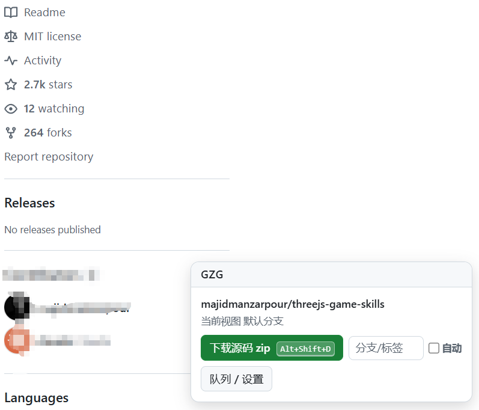
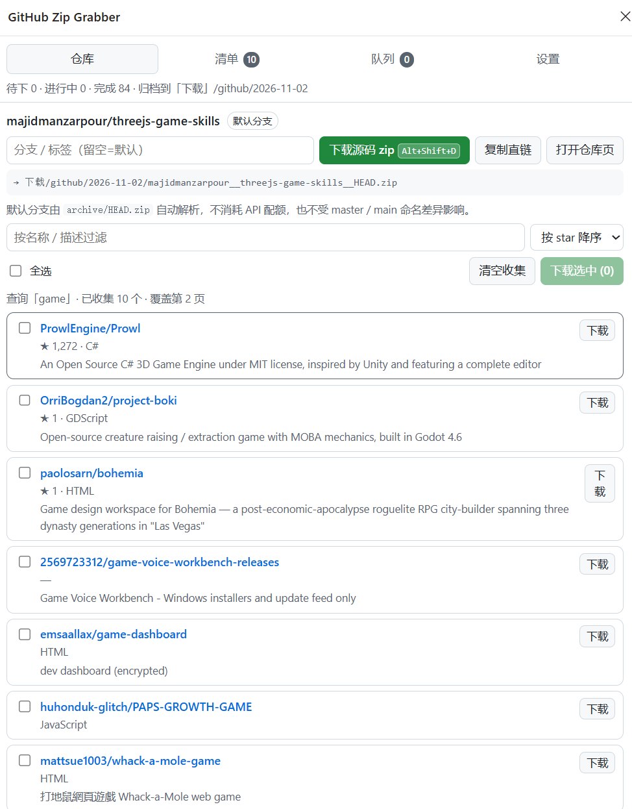
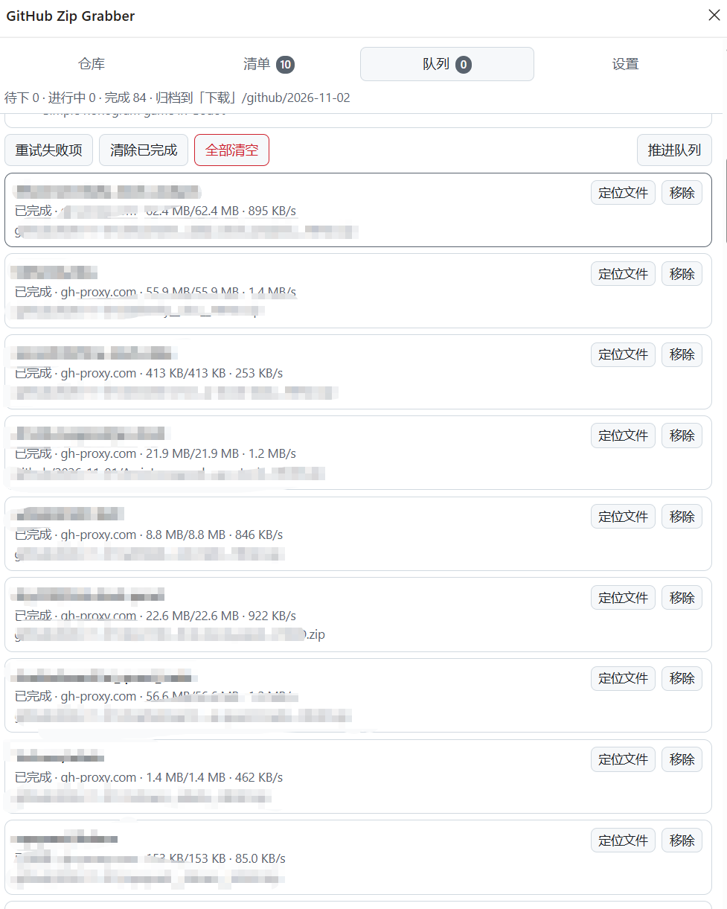
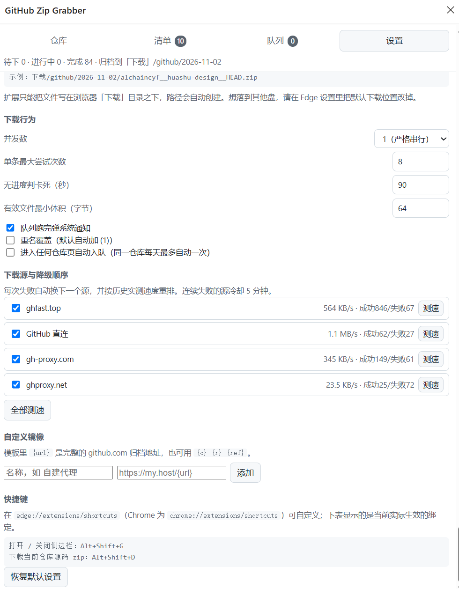

# GitHub Zip Grabber 帮助手册

[← 返回 README](../README.md) ｜ [English manual](help.en.md) ｜ [赞助 / Sponsor](SPONSOR.md)

适用版本：v0.1.2（Edge / Chrome，MV3）

---

## 目录

1. [这是什么](#1-这是什么)
2. [安装与卸载](#2-安装与卸载)
3. [60 秒上手](#3-60-秒上手)
4. [网页控制条](#4-网页控制条)
5. [侧边栏：仓库](#5-侧边栏仓库)
6. [侧边栏：清单（批量下载）](#6-侧边栏清单批量下载)
7. [侧边栏：队列](#7-侧边栏队列)
8. [侧边栏：设置](#8-侧边栏设置)
9. [下载源与镜像](#9-下载源与镜像)
10. [归档规则](#10-归档规则)
11. [自动下载](#11-自动下载)
12. [快捷键](#12-快捷键)
13. [错误对照表](#13-错误对照表)
14. [常见问题 FAQ](#14-常见问题-faq)
15. [已知限制](#15-已知限制)
16. [隐私与安全](#16-隐私与安全)
17. [附录：截图清单](#附录截图清单)
18. [赞助](#18-赞助)

---

## 1. 这是什么

在浏览 GitHub 时顺手把源码 zip 拖回本地：

- 仓库页 → 一键下载默认分支（或指定分支/标签/commit）的 zip
- 搜索结果页 → 把本页（可跨页累加）的仓库收集成清单，多选后排队下载
- 下载在后台串行进行，直连失败自动换镜像，全部按日期自动归档

**不适合的场景**：需要完整 git 历史、子模块、LFS 大文件时请用 `git clone`；要把文件写到任意盘符路径时请改浏览器默认下载位置（见 [已知限制](#15-已知限制)）。


<!-- 拍摄建议：任意仓库页 + 右下角展开的控制条 -->

## 2. 安装与卸载

### 安装

1. 把本仓库下载/克隆到电脑上某个**固定位置**（加载的是目录引用，移走文件夹扩展会失效）
2. 打开 Edge，地址栏输入 `edge://extensions/` 回车
3. 打开页面中的【开发者模式】开关（Edge 在左侧栏底部，Chrome 在右上角）


4. 点击顶部【加载解压缩的扩展】（Chrome 叫 Load unpacked）
5. 选择本目录（含 `manifest.json` 的那一层）
6. 建议点击浏览器工具栏的拼图图标，把 GitHub Zip Grabber 固定住


### 验证安装成功

- 工具栏图标出现，且角标会显示队列中任务数（无任务时角标为空）
- 打开任意 GitHub 仓库页，右下角出现 **GZG** 悬浮条

### 日常更新代码后

在 `edge://extensions/` 的卡片上点【重新加载】（↻）即可，无需重新选择目录。

### 卸载

`edge://extensions/` → 卡片上的【删除】。扩展数据（设置、队列、日志）随之删除；**已下载的 zip 文件不会被动到**。

## 3. 60 秒上手

1. 打开任意 GitHub 仓库，例如 `https://github.com/alchaincyf/huashu-design`
2. 右下角控制条上点 **【下载源码 zip】**
3. 按钮旁出现绿色提示「已入队 xxx → 侧边栏看进度」
4. 下载完成后，到浏览器的**下载**文件夹里找：

```
下载/github/2026-10-10/alchaincyf__huashu-design__HEAD.zip
```

就这么简单。默认分支不需要你关心——扩展用 GitHub 的 `archive/HEAD.zip` 接口，`master` 还是 `main` 都能自动对上。


## 4. 网页控制条

控制条悬浮在页面右下角，点击标题栏 **GZG** 可折叠/展开。GitHub 的页面切换不刷新整页（turbo 导航），扩展会自动跟随，无需手动刷新。

### 仓库页（`github.com/所有者/仓库`）

| 元素 | 说明 |
|---|---|
| 标题行 | 当前识别到的 `所有者/仓库`，以及你正在浏览的分支 |
| 【下载源码 zip `Alt+Shift+D`】 | 把当前仓库加入下载队列（默认分支）。按钮上的按键提示读的是**当前实际生效**的绑定，你改过键它就会跟着变 |
| 分支/标签输入框 | 留空 = 默认分支；可填 `main`、`v1.2.3`、commit 哈希、`feature/x`。填错会失败但不会偷偷改下别的分支 |
| **自动** 勾选框 | 给这一个仓库开自动下载（见 [自动下载](#11-自动下载)） |
| 【队列 / 设置】 | 打开侧边栏 |

在仓库的子页面（issues、releases、代码子目录等）控制条同样可用，识别的仍是这个仓库。

### 搜索结果页（`github.com/search?...type=repositories`）

| 元素 | 说明 |
|---|---|
| 标题行 | `仓库 · 本页 N · 共约 M · 第 X 页` |
| 【收集本页 N 个】 | 把本页仓库并入侧边栏清单（跨页累加、自动去重） |
| 【本页全部入队】 | 本页仓库整页加入下载队列 |
| 【清单 / 多选】 | 打开侧边栏的清单视图 |


> 只有仓库（repositories）搜索支持批量下载；code / issues / users 搜索页控制条会提示不支持。

### 其他 GitHub 页面

控制条只保留【打开队列】入口。

## 5. 侧边栏：仓库

点工具栏图标（或 `Alt+Shift+G`）打开。第一个页签显示**当前标签页**的仓库：

- 仓库名与当前分支徽章
- 分支/标签输入框（留空 = 默认）
- 【下载源码 zip】入队
- 【复制直链】复制 `archive/HEAD.zip` 完整地址
- 【打开仓库页】跳转
- 底部实时预览落盘路径，例如 `→ 下载/github/2026-10-10/alchaincyf__huashu-design__HEAD.zip`



## 6. 侧边栏：清单（批量下载）

这里放的是你在搜索页【收集本页】攒下来的仓库，**跨页累加、按 `所有者/仓库` 去重**。

| 控件 | 说明 |
|---|---|
| 过滤框 | 按名称 / 描述 / 语言实时过滤 |
| 排序 | 按 star 降序 / 按更新时间 / 按名称 / 按抓取顺序 |
| 全选 | 全选当前（过滤后）的列表；再点一次取消 |
| 【清空收集】 | **清空当前展示的这份清单**（注意：可能是其它标签页收集的，面板会回退显示最近有数据的标签；按钮悬停有提示） |
| 【下载选中 (N)】 | 勾选的仓库整批入队，自动跳过已在队列/已下载的 |

每一行显示：`所有者/仓库`、★ star、fork 数、语言、更新日期、描述（截断两行），行尾有单独的【下载】按钮。

> 更新日期会被归一化成 `YYYY-MM-DD` 再排序。GitHub 有三种写法（`Oct 19, 2026, 3:10 PM UTC`、`on Aug 5`、`3 days ago`），扩展都能解析；认不出的宁可不显示，也不会猜一个错误日期。

列表头部会显示来源：`查询「动画skill」· 已收集 10 个 · 覆盖第 2 页`。


> 清空收集后，只要不重新点【收集本页】，清单保持为空。想换一批搜索结果时：清空 → 新搜索 → 收集。

## 7. 侧边栏：队列

队列是全局唯一的，来自所有入口（控制条、快捷键、侧边栏）的任务都排在这里。

顶部按钮：

| 按钮 | 行为 |
|---|---|
| 重试失败项 | 把所有失败/取消的条目重置后重新入队（次数清零） |
| 清除已完成 | 从列表移除 done/failed/canceled 条目（不动已下载的文件） |
| 全部清空 | 清空队列并取消正在下载的任务 |
| 推进队列 | 手动触发一次调度（正常情况不需要） |

每一条显示：

- **状态徽章**：`排队中` / `下载中` / `已完成`（绿）/ `失败`（红）/ `已取消`
- 进度信息：已下载/总大小、实时速度、第几次尝试、当前使用的源
- **目标文件名**（含日期目录），失败时附错误原因（对照 [错误对照表](#13-错误对照表)）
- 行内按钮：失败→【重试】；进行中→【取消】；完成→【定位文件】（在资源管理器中打开）；所有状态→【移除】

底部【运行日志】记录每一次换源、校验失败、重试的细节，排查问题时把它整个复制给我最有用。



## 8. 侧边栏：设置

### 归档

| 设置 | 默认 | 说明 |
|---|---|---|
| 总子目录 | `github` | 下载目录下的一级目录；留空则直接用日期目录；支持嵌套如 `code/github`（非法字符自动替换） |
| 日期目录格式 | `YYYY-MM-DD` | `20261010` / `2026-10` / 不分日期 可选；**用的是本地时区日期**，跨午夜不会归错天 |
| 路径预览 | — | 实时显示示例落盘路径 |

> 扩展只能把文件写在浏览器**默认下载目录之下**。想落到 `E:\github\...`，请把 Edge 的默认下载位置改过去（设置 → 下载 → 位置 → 更改）。

### 下载行为

| 设置 | 默认 | 说明 |
|---|---|---|
| 并发数 | `1` | 1 = 严格串行（一次一个）；最多 4。串行对镜像最友好 |
| 单条最大尝试次数 | `8` | 跨所有源、所有 ref 写法累计，超过即判失败 |
| 无进度判卡死（秒） | `90` | 最低 20。期间字节零增长就掐掉换源 |
| 有效文件最小体积（字节） | `64` | 低于此值判为错误页（最小的真仓库 zip 也有约 150 字节） |
| 队列跑完弹系统通知 | 开 | 批量跑完时提示「成功 X 个，失败 Y 个」 |
| 重名覆盖 | 关 | 关 = 自动加 `(1)`；开 = 覆盖旧文件（谨慎） |
| 进入任何仓库页自动入队 | 关 | 全局自动下载开关，见 [自动下载](#11-自动下载) |

### 下载源与降级顺序

- 列出所有源：勾选 = 启用；标注 `[已停用]` 的行不参与下载但随时可勾回来
- 每行显示：实测速度、成功/失败次数、冷却状态
- 【测速】用一个小仓库真实走一遍该源并记录速度；【全部测速】依次测所有启用的源
- 排序规则：**实测速度高的在前**；从没测过的源排在已测的后面但保证会被尝试；5 分钟内失败过的源冷却沉底
- 【删除】只对自定义镜像有效

### 自定义镜像

填一个模板即可接入任何 GitHub 加速服务：

- `{url}` = 完整归档地址（推荐），例如 `https://my.host/{url}`
- 或拆开用：`https://my.host/{o}/{r}/archive/{ref}.zip`
- 名称可留空，默认用模板域名




### 恢复默认设置

一键还原上表所有默认值（自定义镜像也会被清掉，谨慎点击）。

## 9. 下载源与镜像

工作方式：

1. 队列取出一条任务 → 按当前排序选第一个源 → 发起下载
2. 失败（连不上 / 404 / 卡死 / 校验不过）→ 该源记一次失败并冷却 5 分钟 → 自动换下一个源
3. 全部源都试过仍失败 → 条目标记失败，不影响后续任务

内置源：

| 源 | 说明 |
|---|---|
| GitHub 直连 | `github.com` 原始地址，网络通畅时最快 |
| gh-proxy.com | 公共镜像 |
| ghfast.top | 公共镜像 |
| ghproxy.net | 公共镜像 |

> 公共镜像站生命周期很短，实测已有镜像域名彻底失联。发现某个源长期失败，直接在设置里停用或删除即可；也欢迎接入自建代理。

**为什么没有断点续传**：实测 GitHub 与各镜像都忽略 HTTP `Range` 请求（请求部分字节会返回整个文件），半截文件无法续传，所以失败一律整包重下 + 换源。

## 10. 归档规则

落盘路径公式：

```
{浏览器下载目录}/{总子目录}/{日期}/{所有者}__{仓库}__{ref}.zip
```

示例（默认设置）：

```
下载/github/2026-10-10/alchaincyf__huashu-design__HEAD.zip
下载/github/2026-10-10/octocat__Spoon-Knife__HEAD.zip
下载/github/2026-10-10/foo__bar__refs_heads_dev.zip      ← ref 里的 / 会替换成 _
```

- 同一天重复下载同一仓库 → 自动追加 `(1)`、`(2)`（除非打开"重名覆盖"）
- 日期取**本地时区**，深夜下载不会归到明天
- 队列按 `所有者/仓库@ref` 去重：已在队列或当天已下载过的，再次入队会被跳过（提示「已在队列中/已下载过」）；确要重下，去队列里点【重试】
- 想按项目再分一层？把总子目录写成 `code/github` 即可

## 11. 自动下载

两级开关，都不会打扰你：

| 级别 | 入口 | 生效范围 |
|---|---|---|
| 全局 | 设置 → 【进入任何仓库页自动入队】 | 所有仓库页 |
| 单仓库 | 仓库页控制条的 **自动** 勾选框 | 仅该仓库 |

防失控机制：**同一仓库同一天最多自动入队一次**（反复刷新页面不会把下载目录塞满）。自动入队默认下默认分支。

> 默认全部关闭——打开这个功能前请想清楚磁盘空间。

## 12. 快捷键

| 命令 | 默认值 | 用在哪 |
|---|---|---|
| 打开 / 关闭侧边栏 | `Alt+Shift+G` | 全局 |
| 下载当前仓库源码 zip | `Alt+Shift+D` | 仓库页；等价于点控制条上的【下载源码 zip】 |

两处会显示当前生效的绑定，改过键之后这里也会跟着变：

- 仓库页控制条按钮上的按键徽标
- 侧边栏 → 设置 → 快捷键（列出两条命令的实际绑定，未绑定会写「未绑定」）

自定义：`edge://extensions/shortcuts`（Chrome 为 `chrome://extensions/shortcuts`），找到 GitHub Zip Grabber 的两条命令改键或清空。**扩展无法自行修改快捷键**，这是浏览器安全策略，所以做成"读实际值显示"而不是写死在界面上。

### 按下快捷键后的提示

快捷键与点按钮走的是**同一段代码**，所以提示文字完全一致（不是两套文案）：

| 情况 | 提示 | 颜色 |
|---|---|---|
| 新任务入队 | `已入队 所有者/仓库（HEAD）→ 侧边栏看进度` | 绿 |
| 该仓库已在队列里 | `跳过：已在队列中` | 黄 |
| 该仓库已经下过 | `跳过：已下载过` | 黄 |
| 当前页不是仓库页 | `当前页面不是仓库页，快捷键未触发下载` | 黄 |
| 入队失败 | `失败：具体原因` | 红 |

同时【下载源码 zip】按钮会闪一下绿色光环，直观表示"这个键就是那个按钮"。控制条若处于收起状态，提示会自动展开显示，6 秒后淡掉；输入框里手填的分支名同样会被快捷键路径读取。

非 GitHub 页面（控制条不存在）按快捷键，改由系统通知给出同样的文字。

## 13. 错误对照表

队列条目上显示的失败原因，按出现的字符串对照：

| 错误信息 | 含义 | 处理建议 |
|---|---|---|
| `SERVER_BAD_CONTENT` | 仓库/分支/标签不存在（404） | 检查仓库名拼写；私有仓库需先在浏览器里登录 GitHub；分支名填错也会这样 |
| `NETWORK_FAILED` / `ERR_CONNECTION_RESET/TIMED_OUT` | 网络被重置或超时 | 正常现象，队列会自动换镜像；全部失败时检查网络或更换镜像 |
| `USER_CANCELED` | 下载被取消 | 手动点了取消，或浏览器策略拦截了该下载 |
| `FILE_FAILED` | 磁盘写入失败 | 检查磁盘空间/杀毒软件；把浏览器默认下载目录改到有权限的位置 |
| `发起超时（25s 内没有拿到下载句柄）` | 源接受连接但不吐数据 | 队列已自动换源；若某源频繁出现，去设置里停用它 |
| `源无响应超过 Ns` | 同上（已找回句柄后掐掉） | 同上 |
| `无进度超过 Ns` | 下载中途卡死 | 队列已自动换源重试 |
| `响应 Content-Type=xxx，不是 zip（疑似镜像错误页）` | 镜像用错误页冒充 zip | 队列已自动换源；该源会被冷却 |
| `文件过小（N B < 64 B…）` | 同上（内容不是有效 zip） | 同上 |
| `下载记录丢失，重新排队` | 浏览器侧下载记录消失 | 自动重试，无需处理 |
| `超过最大尝试次数` | 所有重试都用完了 | 看上方最后一次的具体原因；网络好转后点【重试】 |
| `没有可用下载源（检查镜像设置）` | 所有源都被停用 | 去设置里至少勾选一个源 |

## 14. 常见问题 FAQ

**Q：为什么不是"一打开仓库页就自动下载"？**
每次路过都下载会把目录塞满、把镜像打挂。默认是显著按钮 + 可选自动（见 [自动下载](#11-自动下载)），自动也有每天一次的保险。

**Q：下载的是哪个分支？**
默认分支（`HEAD` 自动解析，`master`/`main` 通吃）。想下别的：输入框填分支名/标签/commit。填不存在的东西会得到 404 失败，不会偷偷换成分支下载。

**Q：zip 里有什么、没什么？**
有：该分支的源码快照。没有：`.git` 历史、submodule、Git LFS 文件——这是 GitHub 服务端打包的既定行为，任何工具都一样。需要完整仓库请 `git clone`。

**Q：搜索页能一次抓全部 300 个结果吗？**
现在按页收集：每页点一次【收集本页】，翻页累加。想全自动翻页抓取属于待办功能，欢迎提需求。

**Q：文件去哪了？怎么改下载位置？**
浏览器默认下载目录下的 `github/日期/`。要换地方：扩展里改"总子目录"，或把浏览器默认下载位置改到目标盘（扩展无权写任意绝对路径）。

**Q：公司内网有代理，能用吗？**
可以。在"自定义镜像"里填内网代理的模板（`{url}` 形式），前提是浏览器本身能访问它。

**Q：私有仓库能下吗？**
能，前提是该浏览器已登录 GitHub——扩展走浏览器自己的会话，不额外要求 token。未登录会得到 404。

**Q：GitHub 改版后搜索页只抓到 1 个仓库怎么办？**
先按【收集本页】看数字对不对。抓取器不依赖 GitHub 的 CSS 类名（那些带构建哈希，GitHub 改一次版就全变），而是锚在"仓库标题链接"上、靠结构推导卡片边界，所以普通改版免疫——真出问题多半是 GitHub 换了链接形态。这种时候请带上侧边栏的运行日志提 Issue，并顺手跑一下 `python tests/make_fixtures.py && python tests/e2e_browser.py`，A9 那组夹具会直接指出断在哪一层。

**Q：会拖慢浏览 GitHub 吗？**
控制条只有一个轻量 DOM 查询；下载由浏览器下载引擎接管，不占扩展内存。

**Q：数据会上传吗？**
不会。见 [隐私与安全](#16-隐私与安全)。

## 15. 已知限制

- 落盘只能在浏览器默认下载目录之下（扩展 API 硬边界）
- 不含 `.git` 历史、子模块、LFS（GitHub 服务端打包行为）
- 公共镜像随时可能失效
- GitHub 匿名请求限流：单页 10 条、翻页请适度；数百仓库级别请分批
- 仅识别 `github.com`；Gist / 企业版 GitHub（ghe）不在范围内
- 断点续传不可用（上游忽略 Range 请求），大仓库失败只能整包重下

## 16. 隐私与安全

- **不收集任何数据**：无统计、无上报、无遥测
- 所有状态（设置/队列/日志/搜索收集）只存在浏览器本地 `chrome.storage`
- 网络请求仅限：`github.com`、`codeload.github.com`、`api.github.com` + 你配置的镜像
- 不要求 GitHub token；私有仓库依赖你浏览器里已有的登录态
- 对下载结果做 Content-Type + 体积双重校验，防止镜像错误页冒充源码包

 

> 图片补齐前，文档里对应位置会显示破图与替代文字，属正常现象。

## 18. 赞助

如果这个工具帮你省下了时间，欢迎请作者喝杯咖啡 → [赞助方式](SPONSOR.md)。
